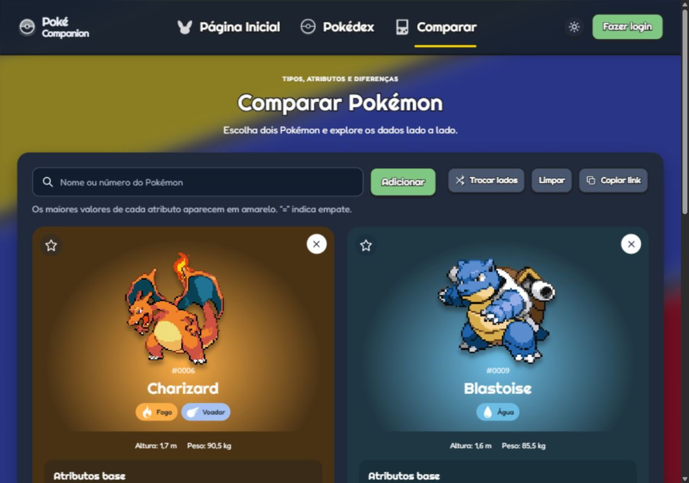
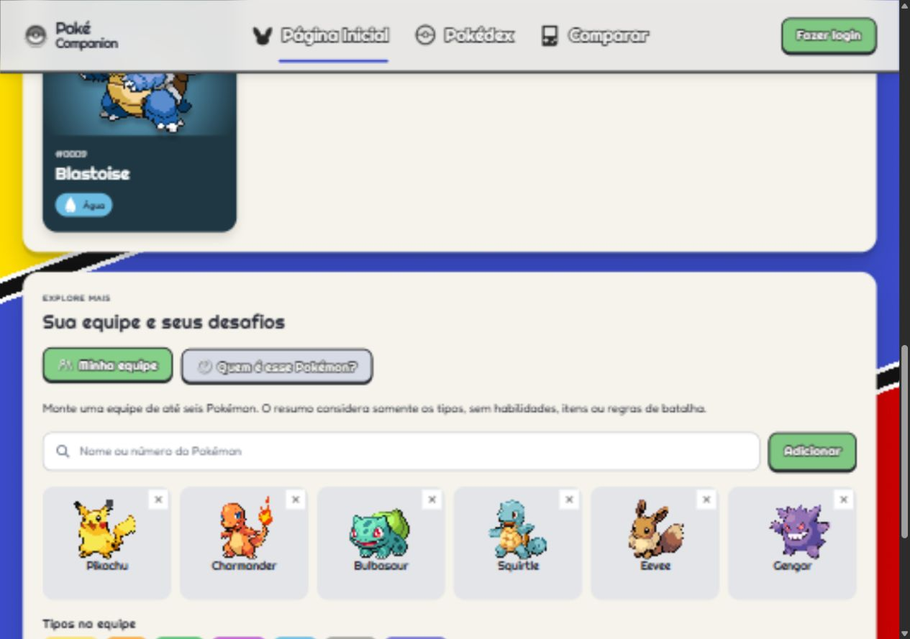
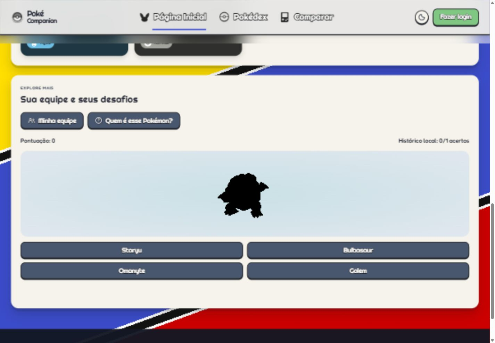

<div align="center">


# PokéCompanion

Pokédex interativa com comparação, favoritos, equipe e quiz.


[](LICENSE)

[Funcionalidades](#funcionalidades) · [Galeria](#galeria) · [Executar](#executar-localmente) · [Aprendizados](#aprendizados)

</div>

Projeto acadêmico em **HTML, CSS e JavaScript**, com dados da PokéAPI. As cores, listras diagonais, sprites e títulos temáticos compõem a identidade da aplicação.


## Funcionalidades

- **Tema claro e escuro:** seletor de sol/lua no cabeçalho, com preferência salva neste navegador e aplicada em todas as páginas.
- **Página inicial:** esteira circular em perspectiva com sete Pokémon, controles de navegação e pausa; iniciais de nove regiões, atalhos por tipo e vistos recentemente.
- **Pokédex:** sugestões por nome ou número a partir do catálogo completo, filtros por tipo, favoritos e lotes de 20 sem cartões duplicados.
- **Ordenação:** por nome ou número, aplicada ao catálogo filtrado antes da paginação.
- **Favoritos por conta:** estrela na Pokédex, no comparador e na ficha; exige login demonstrativo. Favoritos antigos sem autoria podem ser importados explicitamente.
- **Comparador:** dois Pokémon lado a lado, diferenças entre atributos, habilidades, relações de tipos, troca de lados e compartilhamento por URL.
- **Ficha:** cenário visual por tipo, sprites com pixels nítidos e sombra, opção normal/shiny quando disponível e abas de informações, atributos, evoluções e golpes.
- **Equipe:** até seis Pokémon, resumo dos tipos e fraquezas compartilhadas; dados salvos localmente.
- **Quiz:** identificação pela silhueta, quatro alternativas, pontuação e histórico consolidado de acertos no navegador.
- **Interface:** títulos e botões temáticos, ícones vetoriais com contraste, pesquisa por teclado, filtros recolhíveis, rolagem interna discreta nas categorias e fundo desfocado nas páginas internas.
- **Movimento:** a esteira pausa durante interação, foco, aba oculta ou saída da área visível; animações respeitam a preferência por movimento reduzido.
- **Falhas:** mensagens de erro, nova tentativa e tratamento de imagens ausentes e armazenamento indisponível.

## Galeria

Capturas reais da aplicação em execução, com dados demonstrativos.

| Explorar a Pokédex | Guardar favoritos |
| :---: | :---: |
|  |  |

### Comparação de tipos e estatísticas

Charizard recebe dano de Pedra **×4**, Água **×2** e Elétrico **×2**. Blastoise recebe dano de Planta **×2** e Elétrico **×2**.


### Tema escuro

A preferência de tema é compartilhada entre as páginas e mantida ao recarregar.



<details>
<summary>Ver detalhes, login e versão móvel</summary>


<p align="center"></p>

</details>

### Equipe e quiz





## Executar localmente

O projeto não precisa de instalação de dependências nem de etapa de build.

1. Abra um terminal na pasta `PokeCompanion`.
2. Com Python instalado, execute:

   ```bash
   python -m http.server 8000 --bind 127.0.0.1
   ```

3. Acesse [a página inicial local](http://127.0.0.1:8000/html/pagina-inicial.html).

Também é possível usar o Live Server do VS Code e abrir `html/pagina-inicial.html`. Use um servidor local, pois o projeto consulta arquivos SVG com `fetch`.

É necessário acesso à internet para consultar a PokéAPI e carregar imagens e fontes externas.

## Tecnologias e organização

**HTML5 · CSS3 · JavaScript · Fetch API · DOM · localStorage · sessionStorage · Web Crypto**

```text
PokeCompanion/
├── assets/             # Imagens e ícones de tipos
├── css/                # Estilos de cada página e layout compartilhado
├── html/               # Página inicial, Pokédex, comparador, detalhes e login
├── js/                 # Dados, componentes, sessão, favoritos e lógica das telas
├── tests/              # Testes de dados, cache, sessão e favoritos
├── index.html          # Entrada para a página inicial
├── docs/imagens/       # Capturas reais da aplicação
├── LICENSE
└── README.md
```

`css/styleguide.css` define fontes e cores, `css/layout.css` concentra os componentes comuns e os demais CSS tratam cada tela. `css/tema.css` adapta os componentes ao modo escuro e `js/tema.js` restaura a preferência antes de exibir a página. `js/dados.js` reúne consultas, cache, cores, traduções de apoio e relações de tipos. `js/interface.js` contém busca com sugestões, ícones, mensagens, leitura da sessão e alinhamento dos sprites. `js/favoritos.js` isola os IDs por conta; `js/atividades.js` trata equipe e quiz.

### Testes

Com Node.js instalado, execute:

```bash
node --test tests/dados-sessao.test.cjs
```

Os testes usam dados controlados, sem rede ou acesso ao armazenamento de um navegador. Cobrem favoritos sem login, isolamento entre contas, compatibilidade da lista antiga, sessão inválida, armazenamento bloqueado, retorno de login, cache, nova tentativa, números com zeros à esquerda, traduções e multiplicadores de dano.

## Aprendizados

- Consumir uma API REST com `fetch` e tratar carregamento, sucesso e falha.
- Renderizar e atualizar cartões com manipulação do DOM.
- Persistir preferências locais sem depender de um backend.
- Combinar relações de dano para Pokémon com dois tipos.
- Organizar estilos compartilhados e adaptar telas com CSS Grid, Flexbox e media queries.
- Evitar resultados duplicados e respostas antigas sobrescrevendo uma consulta nova.

## Como os dados funcionam

Os dados vêm da [PokéAPI](https://pokeapi.co/docs/v2/). Consultas concluídas são reaproveitadas em memória e em `sessionStorage`, por até um dia. Sugestões usam o índice de espécies; dados adicionais são consultados quando necessários.

Favoritos exigem a sessão local e são separados por nome de usuário. A lista global anterior não tem autoria e não é vinculada automaticamente a uma conta: a Pokédex oferece a importação explícita. Equipe, quiz e comparação permanecem recursos locais do navegador.

O armazenamento depende do endereço e da porta. Limpar os dados do site remove as contas e as preferências; não há sincronização entre dispositivos. Senhas novas usam PBKDF2 no navegador; cadastros antigos são aceitos e atualizados ao entrar. Isso continua sendo um protótipo local, sem autenticação ou autorização de servidor. Use dados e senhas de teste. Novos cadastros exigem localhost ou HTTPS para a Web Crypto.

Fraquezas, resistências e imunidades combinam os tipos defensivos. A equipe e o comparador não simulam uma batalha completa: não calculam habilidades, itens, nível, clima ou escolha de golpes.

O projeto prioriza nomes e textos em português da API, com traduções locais de apoio para habilidades e golpes comuns. Quando faltar tradução, o nome original é identificado. Resumos locais de Pokémon não são descrições oficiais traduzidas. A lista de golpes abrange diferentes jogos, carrega em lotes e informa quantos registros estão disponíveis na busca atual.

## Conferência

- Navegação da esteira, pausa, sprites alinhados e mudança de região.
- Pesquisa com sugestões, navegação por setas/Enter e busca além do lote carregado.
- Visitante impedido de favoritar; cadastro, login e retorno à página de origem.
- Favoritos isolados por conta e recuperação de estados vazios.
- Comparação, troca de lados, link compartilhável e relações entre tipos.
- Ficha de Blastoise, evoluções de Squirtle, golpes e opção shiny.
- Sprites da ficha sem suavização, com sombreamento; ícones de tipos com tamanho independente dos Pokémon.
- Alternância de tema, persistência ao recarregar e contraste dos campos e botões secundários.
- Rolagem interna das categorias, com acesso ao último tipo e indicador fino.
- Equipe de seis membros, limite de tamanho e resumo dos tipos.
- Quiz com revelação da silhueta e bloqueio de respostas repetidas.
- Testes automatizados de dados e sessão e conferência de responsividade.

## Desenvolvimento

Projeto desenvolvido para a **PM3** do curso de **Engenharia de Software / Descomplica UniAmérica**, para praticar desenvolvimento front-end, lógica de programação, integração com API e persistência de dados.

**Equipe:** Adriano Ramos e Luan Augusto.

## Licença e recursos

Código sob a [licença MIT](LICENSE). Dados fornecidos pela [PokéAPI](https://pokeapi.co/); sprites disponibilizados pelo [projeto PokeAPI/sprites](https://github.com/PokeAPI/sprites).

Pokémon e os personagens apresentados pertencem aos seus respectivos titulares. Este é um projeto acadêmico de fãs, sem vínculo oficial com a marca.
