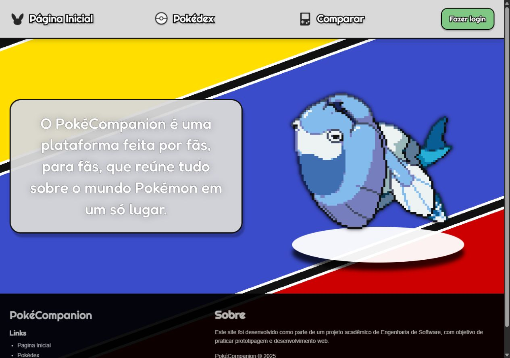
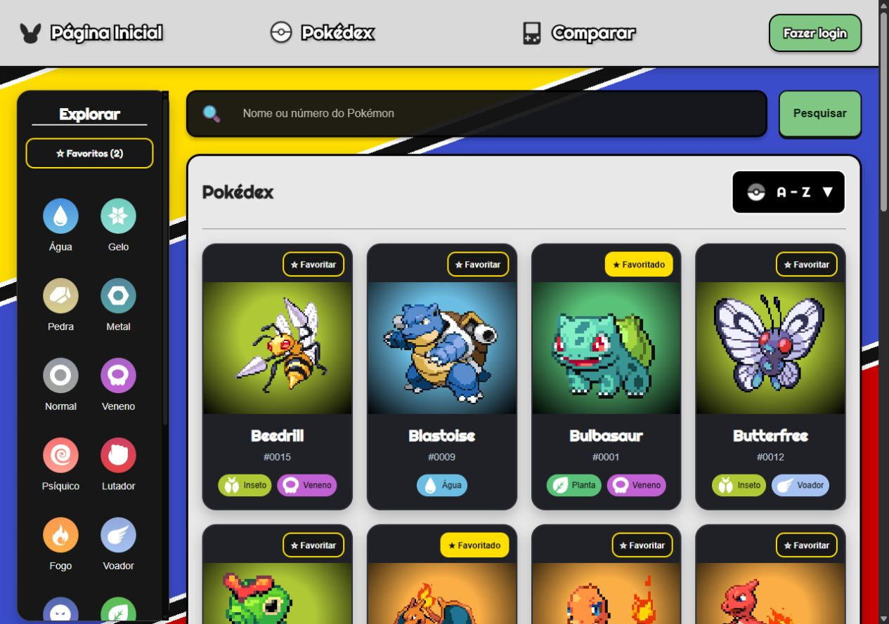
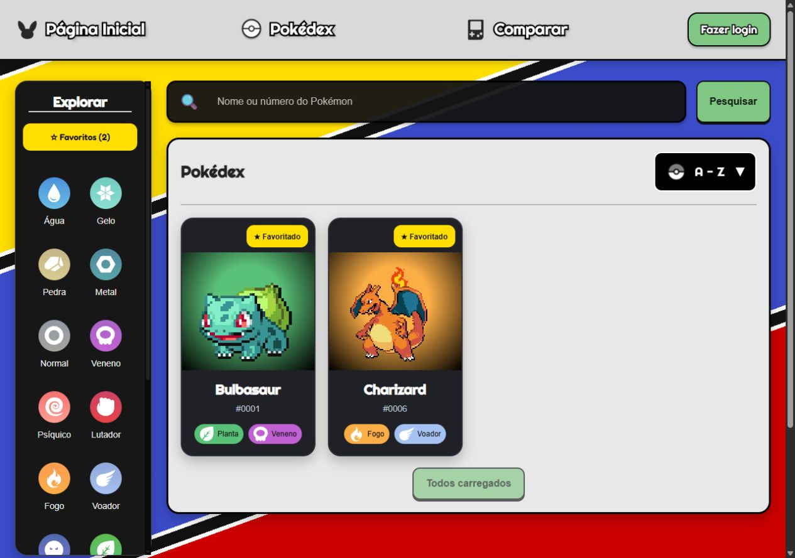
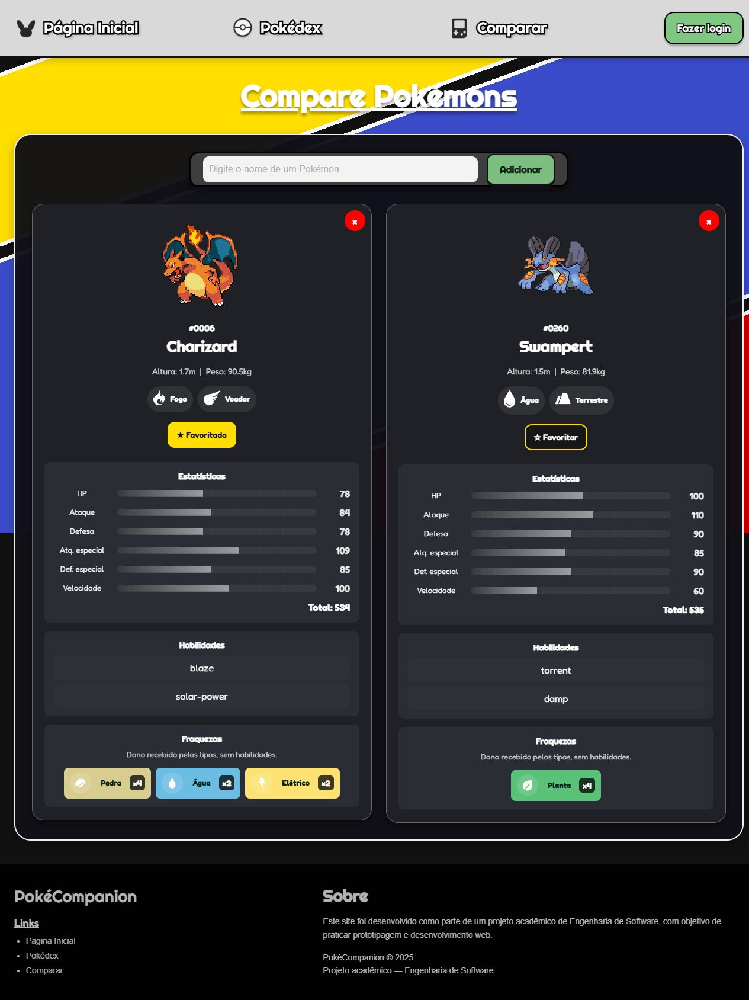
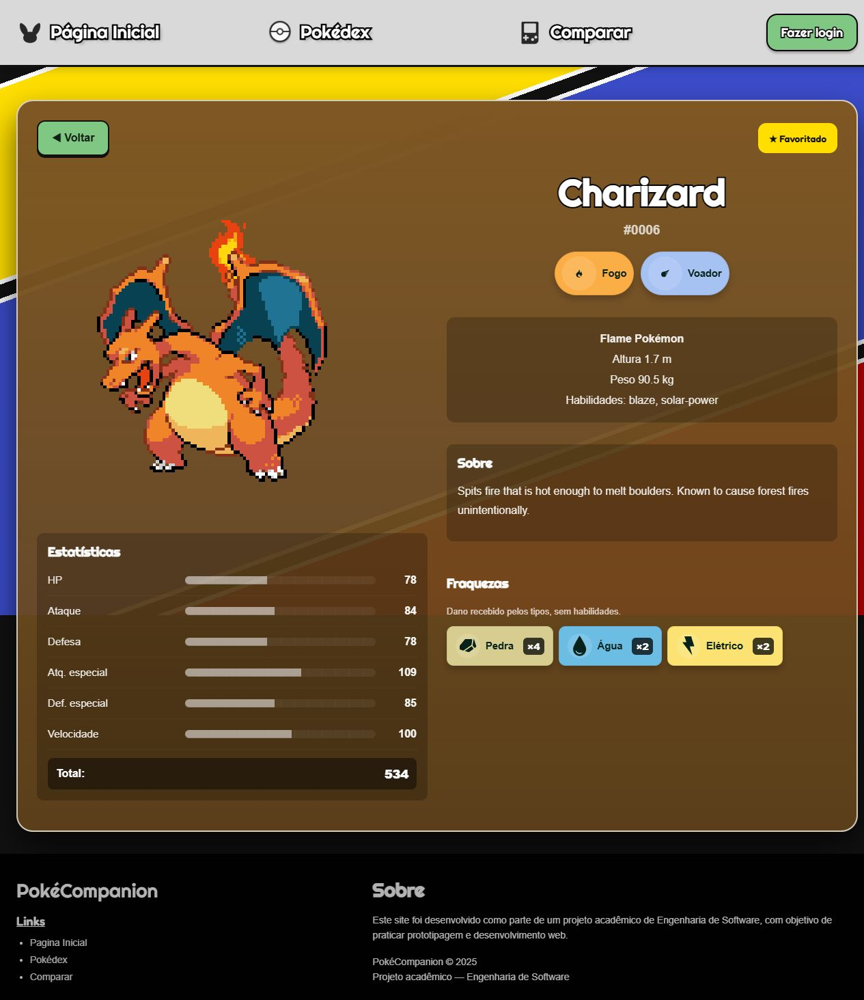
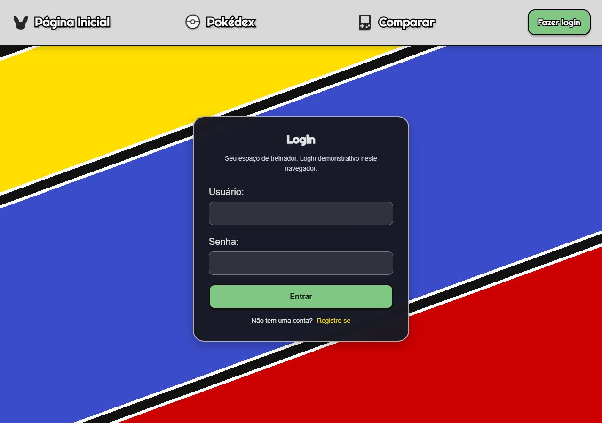
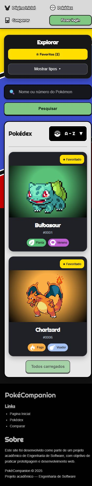

<div align="center">


# PokéCompanion

**Explore. Favorite. Compare.**

Uma Pokédex para fãs de Pokémon, com a identidade visual de um projeto feito por fãs.


[](LICENSE)

[Funcionalidades](#funcionalidades) · [Galeria](#galeria) · [Executar](#executar-localmente) · [Aprendizados](#aprendizados)

</div>

Projeto acadêmico em **HTML, CSS e JavaScript**, com dados da PokéAPI. As cores, listras diagonais, sprites e títulos temáticos compõem a identidade da aplicação.



## Funcionalidades

- **Página inicial:** apresenta um Pokémon aleatório a cada carregamento.
- **Pokédex:** busca por nome ou número, filtros por tipo e carregamento em lotes de 20, sem cartões duplicados.
- **Ordenação:** por nome ou número, aplicada aos Pokémon já carregados.
- **Favoritos:** salvar e remover pela Pokédex, pelo comparador ou pelos detalhes; consultar a lista no botão Favoritos.
- **Comparador:** até dois Pokémon lado a lado, com estatísticas, habilidades, altura, peso e fraquezas.
- **Detalhes:** descrição, tipos e estatísticas de cada Pokémon.
- **Fraquezas:** multiplicadores **×2 e ×4**, considerando a combinação dos tipos defensivos.
- **Layout responsivo:** navegação, cartões e formulários adaptados a telas menores.
- **Interface em português:** tipos e estatísticas traduzidos, filtros recolhíveis no celular e mensagens dentro da página.
- **Login demonstrativo:** cadastro e sessão locais para praticar persistência no navegador.

## Galeria

Capturas reais da aplicação em execução, com o visual atual.

| Explorar a Pokédex | Guardar favoritos |
| :---: | :---: |
|  |  |

### Comparação de tipos e estatísticas

Charizard recebe dano de Pedra **×4**, Água **×2** e Elétrico **×2**. Swampert recebe dano de Planta **×4**.



<details>
<summary>Ver detalhes, login e versão móvel</summary>





<p align="center"></p>

</details>

## Executar localmente

O projeto não precisa de instalação de dependências nem de etapa de build.

1. Abra um terminal na pasta `PokeCompanion`.
2. Com Python instalado, execute:

   ```bash
   python -m http.server 8000 --bind 127.0.0.1
   ```

3. Acesse [a página inicial local](http://127.0.0.1:8000/html/pagina-inicial.html).

Também é possível usar o Live Server do VS Code e abrir `html/pagina-inicial.html`. Use um servidor local, pois o projeto consulta arquivos SVG com `fetch`.

É necessário acesso à internet para consultar a PokéAPI e carregar imagens e fontes externas.

## Tecnologias e organização

**HTML5 · CSS3 · JavaScript · Fetch API · DOM · localStorage · sessionStorage**

```text
PokeCompanion/
├── assets/             # Imagens e ícones de tipos
├── css/                # Estilos de cada página e layout compartilhado
├── html/               # Página inicial, Pokédex, comparador, detalhes e login
├── js/                 # Consultas à API, interface e favoritos compartilhados
├── docs/imagens/       # Capturas reais da aplicação
├── LICENSE
└── README.md
```

`css/layout.css` reúne os ajustes comuns de navegação, fundo e responsividade. `js/favoritos.js` compartilha a persistência dos favoritos entre as três telas, armazenando apenas os IDs. `js/interface.js` centraliza os nomes em português e as mensagens dos formulários.

## Aprendizados

- Consumir uma API REST com `fetch` e tratar carregamento, sucesso e falha.
- Renderizar e atualizar cartões com manipulação do DOM.
- Persistir preferências locais sem depender de um backend.
- Combinar relações de dano para Pokémon com dois tipos.
- Organizar estilos compartilhados e adaptar telas com CSS Grid, Flexbox e media queries.
- Evitar resultados duplicados e respostas antigas sobrescrevendo uma consulta nova.

## Como os dados funcionam

Os dados dos Pokémon vêm da [PokéAPI](https://pokeapi.co/docs/v2/). Os favoritos ficam no navegador e não exigem login. Não existe sincronização entre dispositivos.

O armazenamento local depende do endereço utilizado: trocar o domínio ou a porta cria outro espaço de dados. Limpar os dados do site remove os favoritos, a comparação salva e o cadastro demonstrativo.

As fraquezas consideram apenas os tipos, incluindo resistências e imunidades ao combinar dois tipos. Não simulam habilidades, golpes, nível, clima ou dano completo de uma batalha. Descrições e nomes de habilidades retornados pela API podem permanecer em inglês.

O login é um exercício acadêmico com dados e senhas em `localStorage`. Não é uma autenticação adequada para contas reais.

## Validação manual

- Salvar, remover e recuperar favoritos após recarregar a página.
- Lista vazia e contador de favoritos atualizados.
- Botões de favoritos na Pokédex, nos detalhes e no comparador.
- Fraquezas de Charizard e Swampert com multiplicadores corretos.
- Filtros móveis recolhíveis e abertura de cartões com Enter.
- Mensagens para busca vazia, Pokémon inválido, repetição e limite de comparação.
- Mensagem de usuário inexistente e troca entre login e cadastro.
- Cinco páginas verificadas em larguras de 320, 390, 768 e 1280 pixels.

As capturas acima foram feitas no navegador com a aplicação em execução.

## Desenvolvimento

Projeto desenvolvido para a **PM3** do curso de **Engenharia de Software / Descomplica UniAmérica**, para praticar desenvolvimento front-end, lógica de programação, integração com API e persistência de dados.

**Equipe:** Adriano Ramos e Luan Augusto.

## Licença e recursos

Código sob a [licença MIT](LICENSE). Dados fornecidos pela [PokéAPI](https://pokeapi.co/); sprites disponibilizados pelo [projeto PokeAPI/sprites](https://github.com/PokeAPI/sprites).

Pokémon e os personagens apresentados pertencem aos seus respectivos titulares. Este é um projeto acadêmico de fãs, sem vínculo oficial com a marca.
